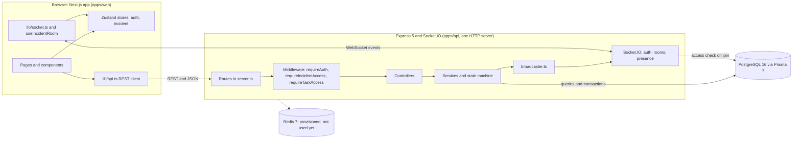
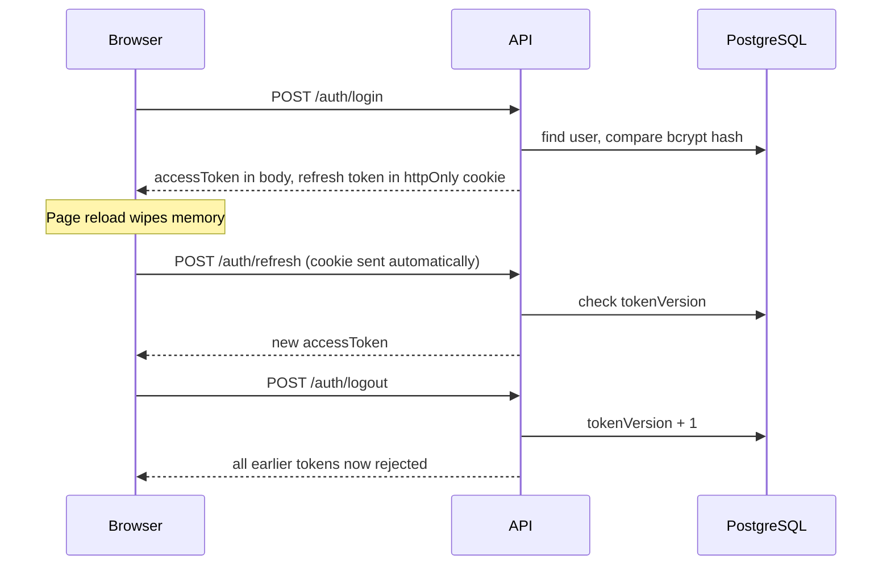

# Architecture

IncidentFlow is a three-tier application: a Next.js web app, an Express API, and PostgreSQL. Realtime updates use Socket.IO attached to the same HTTP server as the REST API, so there is one port and one CORS configuration.

**Core principle: the server is authoritative.** Clients send requests; the server validates, writes to PostgreSQL, then broadcasts the result. Clients never apply a change on their own and wait for the server's event.

## System diagram

## Backend

Request path: **route, middleware, controller, service, Prisma.**

| Layer | Responsibility |
|---|---|
| `server.ts` | Creates the HTTP server, attaches Socket.IO, registers routes and middleware, starts listening |
| `middleware/auth.middleware.ts` | `requireAuth`: verifies the access token and checks `tokenVersion` against the database |
| `middleware/access.middleware.ts` | `requireIncidentAccess`, `requireTaskAccess`: 403 unless the user may open the incident |
| Controllers | Validate input, call a service, map its typed outcome to an HTTP status |
| Services | Business rules. They return outcomes such as `claimed`, `conflict`, `invalid_transition` instead of throwing for expected cases |
| `incident.statemachine.ts` | The only definition of legal status changes |
| `access.ts` | `canAccessIncident`, the single access rule used by REST and sockets |
| `actors.ts` | Resolves user ids to `{ name, role }` in one batched query, shared by snapshots and live events |
| `timeline.service.ts` | The one place timeline events are written (save, attach actor, broadcast) |
| `realtime/broadcaster.ts` | Holds the Socket.IO instance so services can broadcast without importing `server.ts` (avoids a circular import) |

Express 5 forwards errors thrown in async handlers to error middleware, so handlers do not need try/catch for that.

## Frontend

| Area | Role |
|---|---|
| `app/` | Routes: `/login`, `/register`, `/dashboard`, `/incidents`, `/incidents/new`, `/incidents/[id]` |
| `lib/api.ts` | The only place that calls the REST API. Adds the bearer token, sends cookies, throws `ApiError` with the HTTP status |
| `store/auth.store.ts` | User and access token, held in memory only (nothing is persisted to storage) |
| `store/incident.store.ts` | State of the open incident room, updated by socket events |
| `hooks/useIncidentRoom.ts` | Loads the incident over REST, connects the socket, joins the room, maps events to store updates, exposes actions |
| `lib/statemachine.ts` | Client copy of the transition map, used only to decide which buttons to show. The server still validates every change |
| `components/ui/AuthProvider.tsx` | On every page load, calls `POST /auth/refresh` before rendering, so a reload keeps the user signed in |

## Authentication

- Passwords are hashed with bcrypt (cost 12).
- **Access token**: JWT, 15 minutes, payload `{ userId, role, tokenVersion }`, kept in memory on the client.
- **Refresh token**: JWT, 7 days, in an httpOnly cookie that JavaScript cannot read. It is signed with a different secret from the access token, so one cannot be used as the other.
- **Revocation**: both tokens carry the user's `tokenVersion`. `requireAuth` compares it with the database on every request. Logout increments it, which invalidates all of that user's tokens immediately, without a session table.
- Login returns the same error for an unknown email and a wrong password, so the endpoint does not reveal which emails exist.
- Passwords hashes are never returned by the API.

## Authorization

An incident is visible to its **responders** and to **admins**. Everyone else gets 403.

- REST routes under `/incidents/:incidentId/...` use `requireIncidentAccess`. Task routes look up the task's incident first (`requireTaskAccess`).
- Socket.IO uses the same `canAccessIncident` function when a client asks to join a room.
- `GET /incidents` returns only incidents the user belongs to (admins see all).
- The frontend's "no access" screen is only a courtesy. Access is decided on the server.

## Realtime (Socket.IO)

**Connection.** The client passes its access token in the handshake (`auth.token`). A Socket.IO middleware verifies it and the `tokenVersion` before the socket can do anything.

**Rooms.** One room per incident: `incident:<incidentId>`.

**Join flow.** The client emits `incident:join`. The server checks access, adds the socket to the room, then sends:
1. `incident:snapshot`: the full incident (same shape as `GET /incidents/:incidentId`)
2. `presence:list`: who is already in the room
3. `presence:joined` to everyone else

**Reconnection.** On every `connect` event (including automatic reconnects) the client emits `incident:join` again and receives a fresh snapshot, so a client that missed events converges on the server's state. Events are never replayed.

**Presence** is ephemeral. It is derived from the sockets currently in the room and is not stored in the database. `presence:left` is sent from the `disconnecting` event, while the socket still knows its rooms.

### Events

Client to server:

| Event | Payload | Meaning |
|---|---|---|
| `incident:join` | `incidentId: string` | Join a room (access checked) |
| `incident:leave` | `incidentId: string` | Leave a room |

Server to client:

| Event | Payload | Sent when |
|---|---|---|
| `incident:snapshot` | full incident | After joining |
| `presence:list` | `[{ userId, userName }]` | After joining |
| `presence:joined` / `presence:left` | `{ userId, userName }` | Someone connects to or leaves the room |
| `incident:status_changed` | `{ incidentId, status, actorId }` | Status changed |
| `timeline:created` | `{ event }` (includes `actor`) | Any timeline entry is recorded |
| `task:created` | `{ task }` | Task added |
| `task:claimed` | `{ task }` (includes `claimer`) | Task claimed |
| `task:completed` | `{ task }` | Task marked done |
| `comment:created` | `{ comment }` (includes `author`) | Comment posted |
| `decision:created` | `{ decision }` (includes `author`) | Decision logged |
| `responder:added` | `{ userId, name }` | Someone was given access |
| `error` | `{ message }` | Join refused |

Broadcasts are sent **after** the database write succeeds. The client reconciles by replacing its local copy with the data in the event.

## Consistency decisions

| Operation | Mechanism | Why |
|---|---|---|
| Claim a task | Single `UPDATE ... WHERE id = ? AND status = 'UNCLAIMED'`; 1 row means won, 0 means lost | No gap between checking and writing, so two simultaneous claims cannot both succeed |
| Complete a task | `UPDATE ... WHERE status = 'CLAIMED' AND claimedBy = <user>` | Ownership is part of the atomic statement |
| Change status | One transaction: update the incident and insert the timeline event. The update is conditional on the status that was read | The history never disagrees with the state, and two simultaneous changes cannot both apply |
| Create an incident | Incident and its first responder created in one nested write | An incident can never exist with nobody on it |
| Add a responder | `createMany` with `skipDuplicates`; the timeline event is written only if a row was inserted | Safe to repeat |
| Resolve | The API rejects a missing or very short note | The rule cannot be bypassed by skipping the frontend dialog |

When a claim loses, the API returns 409 with the server's current version of the task, and the UI replaces its copy with it.

## Incident state machine

Defined in `incident.statemachine.ts` and enforced in `incidents.service.ts`.

| From | Allowed next |
|---|---|
| DETECTED | ACKNOWLEDGED |
| ACKNOWLEDGED | INVESTIGATING |
| INVESTIGATING | IDENTIFIED |
| IDENTIFIED | MITIGATING, INVESTIGATING |
| MITIGATING | RESOLVED, INVESTIGATING |
| RESOLVED | CLOSED |
| CLOSED | (none) |

## Timeline and summary

Timeline events are append-only rows written by the server: `incident.created`, `incident.status_changed`, `responder.added`, `task.created`, `task.claimed`, `task.completed`, `decision.created`. Users cannot create them directly.

The post-incident summary stores nothing new. Duration, time to acknowledge, time per phase and per-person counts are computed from the incident, its timeline and its related rows when requested.

## PostgreSQL and Prisma

- Schema and migrations live in `apps/api/prisma/`. See [DATABASE.md](DATABASE.md).
- Prisma 7 reads the connection string from `prisma.config.ts` (not from `schema.prisma`) and the client connects through the `@prisma/adapter-pg` driver adapter (`src/db/prisma.ts`).
- Queries that return user-facing data use `select` whitelists so password hashes are never fetched.

## Redis

`docker-compose.yml` starts a Redis container, but no application code connects to it. It is reserved for running more than one API instance (a Socket.IO adapter and shared presence). Until then, run a single API instance.

## Known limitations

See the list in the [README](../README.md#known-limitations).
