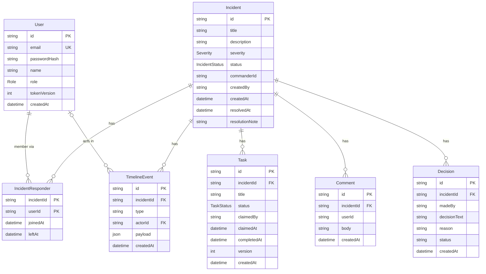

# Database

PostgreSQL 16, managed with Prisma 7. The schema is `apps/api/prisma/schema.prisma`; migrations are in `apps/api/prisma/migrations/`. All ids are UUID strings generated by Prisma.

## ER diagram



## Enums

| Enum | Values |
|---|---|
| `Role` | `ADMIN`, `RESPONDER` |
| `IncidentStatus` | `DETECTED`, `ACKNOWLEDGED`, `INVESTIGATING`, `IDENTIFIED`, `MITIGATING`, `RESOLVED`, `CLOSED` |
| `Severity` | `SEV1`, `SEV2`, `SEV3`, `SEV4` |
| `TaskStatus` | `UNCLAIMED`, `CLAIMED`, `COMPLETED` |

## Models

### User
An account. `email` is unique. `passwordHash` is a bcrypt hash and is never returned by the API. `tokenVersion` starts at 0 and is incremented on logout; tokens carrying an older value are rejected.

### Incident
The central record. `status` defaults to `DETECTED` and only changes through the state machine. `commanderId` is nullable (nothing assigns it yet). `createdBy` is the creator's user id. `resolvedAt` and `resolutionNote` are set when the incident is resolved.

### IncidentResponder
Who has access to an incident. The primary key is `(incidentId, userId)`, so a user can be added once. Presence (who is online right now) is **not** stored here. `leftAt` exists but nothing sets it yet.

### Task
An investigation task. `status` moves `UNCLAIMED`, `CLAIMED`, `COMPLETED`. `claimedBy`, `claimedAt` and `completedAt` are set by the claim and complete operations. `version` is incremented on every claim or completion.

### Comment
A message in the incident discussion (`userId` is the author).

### Decision
A logged decision with its reason (`madeBy` is the user id). `status` is a free string that defaults to `APPROVED`.

### TimelineEvent
An append-only history entry. `type` is a string and `payload` is JSON whose shape depends on the type. `actorId` is nullable (an event without a person). Written only by the server.

| `type` | Typical `payload` |
|---|---|
| `incident.created` | `{ title, severity }` |
| `incident.status_changed` | `{ from, to }` plus `note` when resolving |
| `responder.added` | `{ userId, name }` |
| `task.created` | `{ title }` |
| `task.claimed`, `task.completed` | `{ taskId, title }` |
| `decision.created` | `{ decisionText }` |

## Relationships

Real foreign keys (enforced by the database):

| From | To | Notes |
|---|---|---|
| `IncidentResponder.incidentId` | `Incident.id` | |
| `IncidentResponder.userId` | `User.id` | |
| `Task.incidentId`, `Comment.incidentId`, `Decision.incidentId`, `TimelineEvent.incidentId` | `Incident.id` | |
| `TimelineEvent.actorId` | `User.id` | optional |

Plain string references (no foreign key; the services check them and the API resolves names with a batched lookup):

`Incident.commanderId`, `Incident.createdBy`, `Task.claimedBy`, `Comment.userId`, `Decision.madeBy`.

## Indexes

Beyond the primary keys and the unique `User.email`:

| Index | Speeds up |
|---|---|
| `Task(incidentId)`, `Comment(incidentId)`, `Decision(incidentId)` | Loading one incident's rows |
| `TimelineEvent(incidentId, createdAt)` | The ordered timeline |
| `IncidentResponder(userId)` | Listing the incidents a user belongs to |

## Derived data (not stored)

Duration, time to acknowledge, time per phase, "who is doing what", the allowed next statuses and each person's counts in the summary are all computed from the tables above when requested.

## Working with the schema

```powershell
cd apps/api
npx prisma migrate dev --name <change>   # edit schema.prisma first, then create and apply a migration
npx prisma migrate deploy                # apply existing migrations (CI, production)
npx prisma generate                      # regenerate the typed client
npx prisma db seed                       # optional demo data (see SETUP.md)
```

Prisma 7 reads `DATABASE_URL` from `apps/api/prisma.config.ts`, so run these commands from `apps/api`. Commit the generated migration folder together with the schema change.
